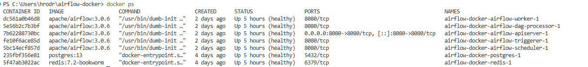
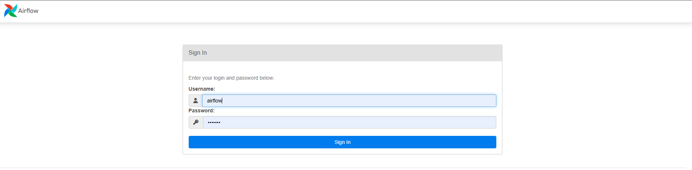
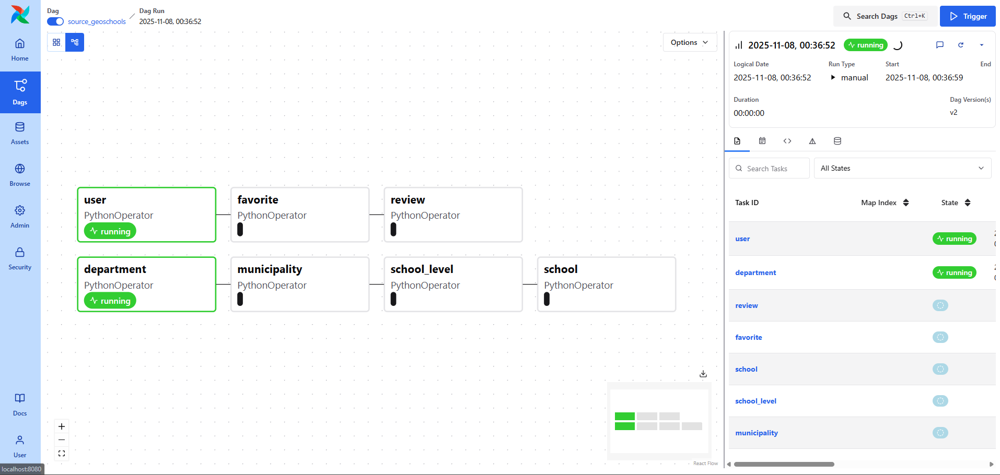
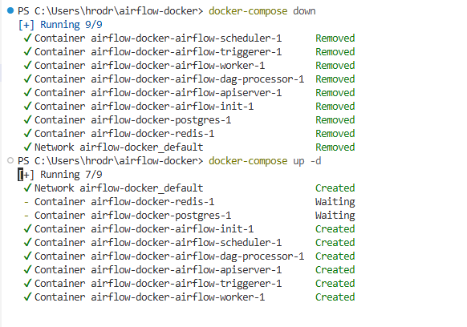
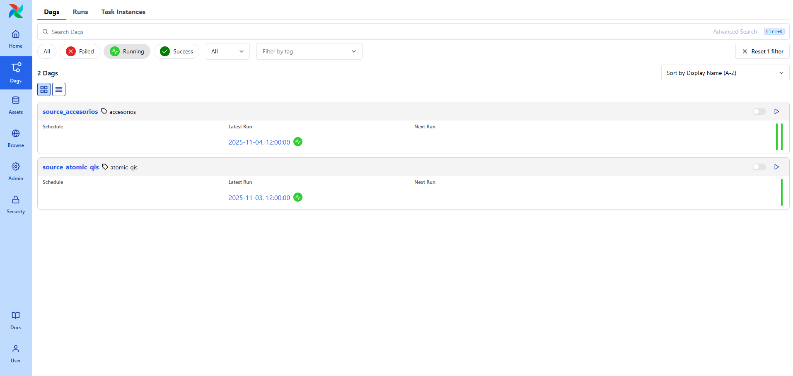

# Manual de Usuario del Sistema ETL  
**Proyecto:** Optimización de procesos ETL en el Data Warehouse de Accesorios Globales TATA  
**Autor:** Henry Javier Rodríguez Gerónimo  
**Versión:** 1.0  
**Tecnología base:** Apache Airflow + Docker + Python  

---

## 1. Descripción General
El sistema ETL automatiza la **extracción, transformación y carga de datos** hacia el Data Warehouse corporativo, garantizando eficiencia, trazabilidad y reducción de tiempos de procesamiento.  
Fue desarrollado utilizando **Apache Airflow** como orquestador y **Docker Compose** como entorno de despliegue.

> *Este manual está dirigido a administradores y analistas encargados de operar, monitorear y mantener los flujos ETL.*

---

## 2. Requisitos del Sistema

### Servidor / Máquina de Ejecución
- **Sistema operativo:** Ubuntu Server 24 o superior  
- **Procesador:** 8 núcleos mínimo  
- **Memoria RAM:** 12 GB o superior  
- **Almacenamiento:** 40 GB libres  
- **Conectividad:** Acceso a SQL Server, MySQL y Oracle  

### Software Necesario
- Docker y Docker Compose  
- Python 3.11  
- Apache Airflow 3.0.6  
- Navegador web (Google Chrome o Edge)

---

## 3. Estructura del Proyecto

```
AIRFLOW-DOCKER/
├── dags/                  # Flujos de trabajo (DAGs)
├── etl/                   # Scripts ETL (extracción, transformación y carga)
├── config/                # Archivos de configuración y variables
├── common/                # Módulos compartidos (conexiones, logs, utilidades)
├── queries/               # Consultas SQL auxiliares
├── logs/                  # Archivos de registro
├── tests/                 # Scripts de prueba
├── docker-compose.yaml    # Definición de servicios
└── requirements.txt       # Dependencias de Python
```

---

## 4. Levantar el Sistema

### Paso 1 – Clonar el repositorio
```bash
git clone https://github.com/hrodriguezg5/airflow-docker.git
cd airflow-docker
```

### Paso 2 – Configurar variables de entorno
Editar el archivo `.env` con las credenciales correspondientes:
```
SQLSERVER_HOST=172.16.10.34
SQLSERVER_USER=hrodriguez
SQLSERVER_PASS=********
MYSQL_HOST=172.16.10.35
MYSQL_USER=etl_user
MYSQL_PASS=********
```

### Paso 3 – Iniciar los servicios
```bash
docker-compose up -d
```

<p align="center">
   
</p>

Servicios desplegados:
- airflow-webserver  
- airflow-scheduler  
- redis  
- postgres  

---

## 5. Acceso al Panel Web de Apache Airflow

1. Abrir el navegador y acceder a:  
   **http://localhost:8080** *(o IP del servidor)*
2. Iniciar sesión:  
   - Usuario: `admin`  
   - Contraseña: configurada en `.env` o generada en la instalación.

<p align="center">
   
</p>

---

## 6. Ejecución de Procesos ETL (DAGs)

1. Ingresar al panel principal de Airflow.  
2. Ubicar el **DAG** correspondiente (por ejemplo, `source_accesorios`).  
3. Activar el DAG con el interruptor azul.  
4. Presionar **▶ Run** para ejecutar manualmente el flujo.  
5. Supervisar el progreso desde:
   - **Graph View:** visualiza la secuencia de tareas.  
   - **Tree View:** muestra el historial de ejecuciones.  
   - **Logs:** acceso al detalle de cada tarea (extract, transform, load).

<p align="center">
   
</p>

---

## 7. Monitoreo y Mantenimiento

- **Logs:** disponibles en `/logs/` o directamente desde la interfaz web.  
- **Reintentos automáticos:** Airflow permite volver a ejecutar tareas fallidas.  
- **Respaldo:** utilizar el script `backup_airflow.ps1` o configurar DAGs de respaldo automático.  
- **Actualizaciones:** mantener sincronizado el repositorio con Git (`git pull`).  

> *Sugerencia:* programa tareas de mantenimiento semanales para limpiar logs y verificar integridad de DAGs.

---

## 8. Restauración y Recuperación

En caso de error o pérdida de servicio:
```bash
docker-compose down
```
Restaurar respaldos de Postgres y DAGs desde el directorio `/backup/`, luego ejecutar:
```bash
docker-compose up -d
```

<p align="center">
   
</p>


---

## 9. Capacitación Básica para Usuarios

- Familiarizarse con la interfaz web de Airflow.  
- No modificar DAGs sin autorización del administrador.  
- Reportar errores con logs adjuntos.  
- Utilizar GitHub para seguimiento y control de versiones.

<p align="center">
   
</p>

---

## 10. Recomendaciones de Operación

- Verificar periódicamente el estado de los contenedores.  
- Automatizar limpiezas de logs cada 30 días.  
- Mantener actualizados los controladores ODBC y librerías Python.  
- Documentar todos los cambios o nuevas implementaciones.  
- Realizar respaldos completos antes de actualizar o agregar nuevos DAGs.

---

## 11. Conclusión

El sistema ETL desarrollado con Apache Airflow proporciona **automatización, trazabilidad y control total** sobre los procesos de integración de datos.  
Su diseño modular y contenerizado permite escalar, mantener y mejorar los flujos ETL de forma ágil y segura.

> *Sistema validado con una mejora del ~29% en los tiempos de ejecución promedio.*
